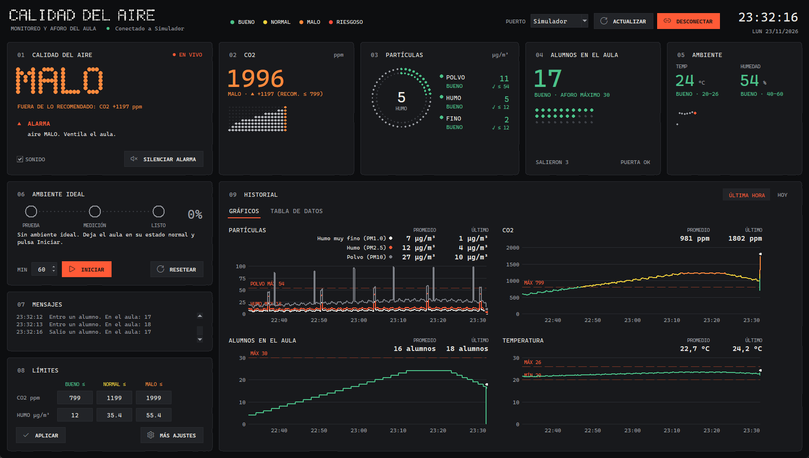

# Estación de calidad del aire (Raspberry Pi Pico W + MicroPython, POO)

Mide CO2, temperatura, humedad, **polvo y humo** en un aula, **cuenta cuántas
personas entran y salen** por la puerta, califica el aire y lo muestra en una pantalla OLED y por consola. Si falta algún dispositivo, avisa y sigue
midiendo con los demás.

Incluye un **software de control para la PC** (`control_estacion.py`) que muestra las lecturas en vivo,
da la alarma cuando el aire es MALO o MUY MALO, permite cambiar los ajustes de la estación y
medir el **ambiente ideal** del aula, cuenta los **alumnos en el aula** y los que salieron, y
guarda un **historial** con fecha y hora (ver más abajo).

## Hardware

Placa: **Raspberry Pi Pico W** (RP2040) con MicroPython.

| Componente | Qué mide | Conexión | Pines Pico W (GPxx = pin físico) | Alimentación |
|---|---|---|---|---|
| SCD40 | CO2, temperatura, humedad | I2C0 (0x62) | SDA GP4 (6), SCL GP5 (7) | 3V3 OUT (36) |
| OLED SSD1306 128x64 | (pantalla) | I2C0 (0x3C) | SDA GP4 (6), SCL GP5 (7) | 3V3 OUT (36) |
| PMS5003 | PM1.0, PM2.5, PM10 | UART0 9600 | TX sensor → GP1 (2), RX sensor → GP0 (1) | VBUS 5 V (40) |
| DHT11 | Temperatura, humedad (respaldo) | 1 cable de datos | DATA → GP15 (20) | 3V3 OUT (36) |
| HC-SR04 exterior (puerta) | Personas que pasan | TRIG / ECHO | TRIG GP16 (21), ECHO GP17 (22) | VBUS 5 V (40) |
| HC-SR04 interior (puerta) | Personas que pasan | TRIG / ECHO | TRIG GP18 (24), ECHO GP19 (25) | VBUS 5 V (40) |

- El SCD40 y la OLED comparten los mismos dos cables I2C.
- **GND:** todos los GND juntos, a cualquier pin GND del Pico (3, 8, 13, 18, 23, 28, 33 o 38).
- **VBUS (pin 40)** entrega los 5 V del cable USB: alcanza para el PMS5003 y los dos HC-SR04.
  **3V3 OUT (pin 36)** es la salida de 3,3 V. No uses el pin 39 (VSYS) ni el 37 (3V3_EN).
- No uses GP23, GP24, GP25 ni GP29: en el Pico W están ocupados por el chip WiFi.

**Importante:** los pines del Pico W **no soportan 5 V**. El pin ECHO de cada HC-SR04 entrega 5 V:
conéctalo con un divisor de voltaje (por ejemplo, 1 kΩ en serie y 2 kΩ a tierra) para bajarlo
a 3,3 V. El TX del PMS5003 ya trabaja a 3,3 V y va directo.

Si quieres cambiar algún pin, se cambia en la parte *Configuración* de `main.py`.

## Archivos

```
proyecto richar/
├── README.md                  Este documento
├── control_estacion.py        Software de control para la PC (no se copia a la placa)
├── componentes.py             Piezas visuales: colores, íconos, botones, paneles, tarjetas (PC)
├── estadisticas.py            Historial: graba con fecha y hora y dibuja los gráficos (PC)
├── exportar_excel.py          Exporta los registros a un Excel con fórmulas y gráficos (PC)
├── captura.png                Cómo se ve el software de control
├── registros/                 Se crea sola: un archivo .csv por día con las mediciones
└── jhonell.sensorcalidad/     Todo lo que va al Pico W (y nada más)
    ├── main.py                Clase EstacionCalidadAire (programa principal)
    ├── Sensor.py              Clase Sensor (clase base)
    ├── Sensorgas.py           Clase SensorGas (SCD40), hereda de Sensor
    ├── SensorAmbiental.py     Clase SensorAmbiental (PMS5003), hereda de Sensor
    ├── SensorDHT11.py         Clase SensorDHT11 (DHT11), hereda de Sensor
    ├── Comunicador.py         Clase Comunicador (OLED, consola y calificación)
    ├── EnlacePC.py            Clase EnlacePC (comunicación con el software de la PC)
    ├── AmbienteIdeal.py       Clase AmbienteIdeal (prueba de funcionamiento + ambiente ideal)
    ├── SensorUltrasonico.py   Clase SensorUltrasonico (HC-SR04), hereda de Sensor
    ├── ContadorPersonas.py    Clase ContadorPersonas (entradas y salidas por la puerta)
    └── Contador.py            Clase Contador (temporizador)
```

Regla simple: **todo lo que está dentro de `jhonell.sensorcalidad/` se copia al Pico W**;
lo que está afuera se queda en la PC.

## Clases

```
                Sensor  (clase base)
                + nombre
                + leer()            <- cada hija la implementa
                + tiene_datos()
                + detener()         <- apaga el sensor al cerrar
                # _caducado(), _aviso(), _borrar_datos()
             ▲                  ▲                    ▲
             │ hereda           │ hereda             │ hereda
   SensorGas (SCD40)   SensorAmbiental (PMS5003)   SensorDHT11 (DHT11)
   + co2               + pm1, pm25, pm10           + temperatura
   + temperatura       + calentando()              + humedad
   + humedad           + dormir(), despertar()     + leer()
   + conectado         + leer()
   + leer(), detener()

        Comunicador                     Contador
        + calidad_aire(pm25, co2)       + intervalo_ms
        + mostrar(gas, ambiental,       + listo()
                  dht, ideal)
        + pagina (rota 5 páginas)
        + resumen(), cambiar_limites()

        EnlacePC
        + enviar_datos(datos)
        + responder(ok, mensaje)
        + recibir() -> comandos

        AmbienteIdeal
        + estado: SIN_IDEAL / PROBANDO / MIDIENDO / LISTO / FALLO
        + iniciar(minutos), resetear()
        + actualizar(lecturas, sensores)
        + progreso(), valor(variable), resumen()

        SensorUltrasonico (hereda de Sensor)    ContadorPersonas
        + distancia                             + dentro, entradas, salidas
        + leer() -> cm o None                   + umbral_cm
        + responde()                            + actualizar(), resetear()
                                                + cambiar_umbral(cm), resumen()

        EstacionCalidadAire  (clase principal, contiene a las demás)
        + gas: SensorGas
        + ambiental: SensorAmbiental
        + dht: SensorDHT11
        + pantalla: Comunicador
        + lectura, refresco: Contador
        + enlace: EnlacePC
        + ideal: AmbienteIdeal
        + puerta_ext, puerta_int: SensorUltrasonico
        + personas: ContadorPersonas
        + paso()
        + iniciar(), detener()
```

| Concepto de POO | Dónde se usa |
|---|---|
| Herencia | `SensorGas`, `SensorAmbiental`, `SensorDHT11` y `SensorUltrasonico` heredan de `Sensor` |
| Polimorfismo | `EstacionCalidadAire` llama a `leer()` y `detener()` en cada sensor de su lista |
| Abstracción | `Sensor` define qué hace un sensor, sin decir cómo |
| Encapsulamiento | Los detalles internos son métodos y atributos con `_` |
| Composición | `EstacionCalidadAire` contiene sensores, pantalla, temporizadores, el ambiente ideal y el contador de personas; `ContadorPersonas` contiene los dos `SensorUltrasonico` |

## Funcionamiento

1. Al encender, `EstacionCalidadAire` crea el bus I2C0, el puerto serie UART0, los sensores y la pantalla.
2. Cada 1 s llama a `leer()` de los tres sensores (el DHT11 lee como máximo cada 2,5 s).
3. Cada 2 s `Comunicador` actualiza la OLED y la consola. La pantalla rota cada 5 s entre
   5 páginas, con el título en la franja amarilla superior:
   - **CALIDAD DE AIRE**: CO2, temperatura y humedad
   - **POLVO Y HUMO**: el nivel del polvo y del humo (BUENO, MODERADO, MALO, MUY MALO) en vez
     del número, y qué hacer (`Sin alertas`, `Cierra ventanas`, `Ventila el aula`...). Si hay
     alerta, el título cambia a `ALERTA: HUMO`, `ALERTA: POLVO` o `HUMO Y POLVO!`
   - **ESTADO DEL AIRE**: calificación general, por CO2 y por humo
   - **PERSONAS**: cuántas hay dentro, cuántas entraron y cuántas salieron
   - **VS IDEAL**: progreso de la medición, o cuánto se aleja cada lectura del ambiente ideal
4. Temperatura y humedad salen del SCD40 (más preciso); si no tiene dato, se usa el DHT11.
5. Los primeros 30 s aparece `AIRE: CALENTANDO` (el PMS5003 se está estabilizando).
6. Si falta un dispositivo al encender, o se desconecta después, sus valores pasan a `--`
   y el programa sigue; el SCD40 se reconecta solo.
7. Al detenerlo desde Thonny (Ctrl+C), apaga la medición del SCD40.
8. Cada vez que actualiza la pantalla, también envía las lecturas a la PC por el cable USB
   y atiende los comandos que lleguen desde el software de control.
9. En cada vuelta del ciclo (cada ~20 ms) revisa uno de los dos sensores de la puerta.

## Conteo de personas

Dos HC-SR04 en el marco de la puerta, a la altura de la cintura, apuntando hacia el otro lado y
separados unos 15-20 cm: el **exterior** del lado del pasillo y el **interior** del lado del aula.

```
   PASILLO      [EXTERIOR]  ->  persona entra  ->  [INTERIOR]      AULA
```

- Un sensor está *activo* cuando tiene algo más cerca que el **umbral** (70 cm por defecto).
  El umbral debe ser menor que el ancho de la puerta, para que el marco del frente no cuente.
- El primero que se activa indica de dónde viene la persona. Se cuenta cuando la puerta queda
  libre y el último en liberarse es el otro sensor: exterior → interior = **entrada**;
  interior → exterior = **salida**.
- Si alguien se asoma y se regresa, no se cuenta. Una lectura suelta tampoco: un cambio debe
  repetirse 2 veces seguidas.
- **Alumnos en el aula** = entradas − salidas, y nunca baja de 0. El software muestra los
  alumnos en el aula y cuántos salieron.
- Los totales se guardan en el Pico W (`conteo.json`) y se recuperan al encender.
  **Reiniciar conteo** los pone en cero (por ejemplo, al empezar el día).
- Los sensores se leen de a uno, alternándolos, para que el eco de uno no confunda al otro.
- Limitación: si dos personas cruzan a la vez, muy juntas, cuenta una sola.

## Ambiente ideal (prueba de funcionamiento + medición)

Sirve para saber cómo es el aula "en condiciones normales" y comparar contra eso.
Se inicia desde el software de la PC y pasa por tres etapas:

1. **Prueba de funcionamiento** (hasta 90 s): comprueba que cada dispositivo responda.
   El SCD40 y el PMS5003 son obligatorios; el DHT11 y la OLED solo se informan.
   Espera los 30 s de calentamiento del PMS5003. Si un sensor obligatorio no responde,
   termina en **FALLO** e indica cuál.
2. **Medición** (60 min por defecto, de 1 a 240): promedia todas las lecturas del ambiente.
   Durante la medición no se puede dormir el PMS5003. **No ventilar ni cambiar el aula.**
3. **Listo:** guarda los promedios en el Pico W (`ideal.json`). Se recuperan al encender.

Desde entonces, cada tarjeta del software muestra `Ideal: 650 (+120)`: el valor ideal y cuánto
se aleja la lectura actual. La OLED lo muestra en la página **VS IDEAL**.

**Resetear** borra el ambiente ideal guardado (pide confirmación). Durante una medición, el mismo
botón dice **Cancelar**: detiene la medición y también borra el ideal anterior.
Si el Pico W se reinicia a mitad de la medición, esa medición se pierde y hay que iniciarla de nuevo.

## Calificación del aire y alertas

### Nombres simples
El sensor PMS5003 mide partículas con nombres técnicos (PM10, PM2.5, PM1.0) que son difíciles
de entender. En la pantalla y en el software se muestran con nombres simples:

| En pantalla | Nombre técnico | Qué es |
|---|---|---|
| **Polvo** | PM10 | Partículas de hasta 10 µm: polvo, polen, tiza |
| **Humo** | PM2.5 | Partículas de hasta 2,5 µm: humo, gases de autos |
| **Humo muy fino** | PM1.0 | Partículas de hasta 1 µm: humo de combustión |

En la OLED, "HUMO" muestra el peor entre el humo y el humo muy fino. En el software de la PC,
el nombre técnico aparece chico junto al número, como referencia para el informe.

La calificación general es la **peor** entre CO2, humo y polvo:

| Nivel | CO2 (ppm) | Humo y humo muy fino (µg/m³) | Polvo (µg/m³) |
|---|---|---|---|
| BUENO | menos de 800 | hasta 12 | hasta 54 |
| MODERADO | menos de 1200 | hasta 35,4 | hasta 154 |
| MALO | menos de 2000 | hasta 55,4 | hasta 254 |
| MUY MALO | 2000 o más | más de 55,4 | más de 254 |

Los cortes del humo (PM2.5) y del polvo (PM10) son los del índice de calidad del aire de la EPA.
El humo muy fino (PM1.0) no tiene límites oficiales, así que se califica con los del humo
(no entra en la calificación general).

### Qué significa cada uno
| Medición | Partículas | Ejemplos | Llegan hasta |
|---|---|---|---|
| Polvo (PM10) | hasta 10 µm (unas 7 veces más finas que un cabello) | polvo, polen, tiza | nariz y garganta |
| Humo (PM2.5) | hasta 2,5 µm | humo, gases de autos | los pulmones |
| Humo muy fino (PM1.0) | hasta 1 µm | humo de combustión | pueden pasar a la sangre |

### Alertas de partículas
Las partículas se muestran como **alertas** (el nivel en grande y el número chico debajo).
Cuando una llega a MALO o peor, se indica la causa probable:

| Alerta | Cuándo | Qué hacer |
|---|---|---|
| **Humo o contaminación** | humo o humo muy fino en MALO o peor | Si viene de afuera, cerrar las ventanas |
| **Mucho polvo** | polvo en MALO o peor | Ventilar y evitar levantar polvo |
| **Humo y polvo** | las dos anteriores | Revisar de dónde vienen antes de abrir |

Mientras el sensor de polvo y humo (PMS5003) se calienta (30 s) no se dan alertas.

## Cómo cargarlo al Pico W

1. Grabar el firmware MicroPython para **Pico W** (`RPI_PICO_W`, v1.23.0 o más nuevo): mantener
   apretado el botón **BOOTSEL**, conectar el USB y arrastrar el archivo `.uf2` a la unidad
   `RPI-RP2` que aparece. (También se puede hacer desde Thonny: *Herramientas → Opciones →
   Intérprete → MicroPython (Raspberry Pi Pico) → Instalar o actualizar MicroPython*.)
2. Instalar el controlador de la pantalla: `mpremote mip install ssd1306`
   (el Pico W necesita internet para esto; si no, copia `ssd1306.py` a mano desde
   micropython-lib). El módulo `dht` ya viene incluido en el firmware.
3. Copiar los 11 archivos de `jhonell.sensorcalidad/` a la raíz de la placa (desde dentro de esa carpeta):
   `mpremote cp Sensor.py Sensorgas.py SensorAmbiental.py SensorDHT11.py SensorUltrasonico.py ContadorPersonas.py Comunicador.py EnlacePC.py AmbienteIdeal.py Contador.py main.py :`
4. Reiniciar (desconectar y conectar el USB). Debe aparecer `Dispositivos I2C: ['0x3c', '0x62']`.

## Software de control (PC)



### Cómo está organizada la ventana
Diseño oscuro tipo tablero: tarjetas numeradas de esquinas redondeadas, letras de ancho fijo
(Cascadia Mono en Windows 11, Consolas en Windows 10), **números grandes hechos de puntos** como
un panel LED y un solo color de acento (naranja). Los colores de nivel se usan solo para la
calidad del aire: verde BUENO, ámbar MODERADO, naranja MALO y rojo MUY MALO. Pensada para una
pantalla de 1920×1080 (la ventana mide unos 1730×970). No hace falta instalar nada.

| Tarjeta | Qué tiene |
|---|---|
| Encabezado | Título, estado de la conexión, *Puerto*, *Actualizar*, *Conectar/Desconectar*, hora y fecha |
| **01 Calidad del aire** | La calificación en letras de puntos grandes ("MUY MALO") con su color, "● EN VIVO", la alerta con qué hacer, *Sonido* y *Silenciar alarma* |
| **02 CO2** | El número en puntos (con el color del nivel si no está BUENO) y un ecualizador de puntos con las últimas lecturas |
| **03 Partículas** | Un anillo de puntos que se llena según el peor nivel, el humo en el centro, y polvo, humo y humo muy fino con su número y su nivel |
| **04 Alumnos en el aula** | Cuántos hay (contados en la puerta), una grilla de 30 puntos con el aforo, cuántos salieron y si la puerta funciona |
| **05 Ambiente** | Temperatura y humedad, con una línea de puntos de la temperatura |
| **06 Ambiente ideal** | Tres pasos (PRUEBA → MEDICIÓN → LISTO) con el porcentaje, la duración, *Iniciar* y *Resetear* |
| **07 Mensajes** | Lo que va pasando: conexiones, cambios, entradas y salidas, errores |
| **08 Límites** | Límites de la calificación (CO2 y humo), *Aplicar* y **Más ajustes** |
| **09 Historial** | Gráficos de puntos de la última hora o de hoy, y la tabla de datos (ver abajo) |

**Colores: se ve de un vistazo si cada valor es bueno o malo.** Todos los números, la
calificación, las filas de la tabla y las líneas de los gráficos usan los mismos 4 colores
(la leyenda está arriba de la ventana):

| Color | Nivel | CO2 (ppm) | Humo (µg/m³) | Polvo (µg/m³) | Temperatura (°C) | Humedad (%) | Alumnos |
|---|---|---|---|---|---|---|---|
| 🟢 verde | **BUENO** | hasta 799 | hasta 12 | hasta 54 | 20–26 | 40–60 | hasta 24 |
| 🟡 amarillo | **NORMAL** | hasta 1199 | hasta 35,4 | hasta 154 | 18–28 | 30–70 | hasta 30 (aforo) |
| 🟠 naranja | **MALO** | hasta 1999 | hasta 55,4 | hasta 254 | 16–30 | 20–80 | hasta 35 |
| 🔴 rojo | **RIESGOSO** | más | más | más | fuera de eso | fuera de eso | más de 35 |

Los cortes de CO2 y humo son los límites que tiene la estación (si los cambias en *Límites*,
cambian también los colores). En la PC, MODERADO se muestra como **NORMAL** y MUY MALO como
**RIESGOSO**; la pantalla OLED del Pico W sigue usando los nombres originales.

**Indicadores de cantidades malas.** Cada lectura se compara con lo que se supone que debería
haber en el aula (clase `Referencias`):

| Medición | Recomendado | De dónde sale |
|---|---|---|
| CO2 | ≤ 799 ppm | El máximo de BUENO de la estación (si cambias los límites, cambia también) |
| Humo y humo muy fino | ≤ 12 µg/m³ | Igual que el CO2 |
| Polvo | ≤ 54 µg/m³ | BUENO del índice de la EPA |
| Temperatura | 20–26 °C | Rango de confort habitual para un aula |
| Humedad | 40–60 % | Rango de confort habitual |
| Alumnos | ≤ 30 | Aforo del aula |

- Debajo de cada número: **✓** en verde si está bien; **▲ +1090** en naranja si se pasa (y por cuánto);
  **▼ -1.5** en ámbar si le falta (temperatura o humedad bajas).
- La tarjeta 01 resume todo: `FUERA DE LO RECOMENDADO: CO2 +1090 ppm · POLVO +161 µg/m³`, o
  `✓ TODO DENTRO DE LO RECOMENDADO`.
- En los gráficos, una **línea punteada naranja** marca el límite (`MÁX 799`, `MÍN 20`) y el tramo
  de la línea que queda del lado malo se pinta en naranja (o ámbar si es por debajo).

**Más ajustes** abre una ventana aparte con lo que no entra en la principal:
- cada cuánto lee los sensores y actualiza la pantalla;
- dormir o despertar el sensor de polvo y humo (PMS5003);
- la puerta: si los dos sensores responden, el umbral y *Reiniciar conteo*;
- el registro: lugar, *Grabar cada N min*, cuántos registros van hoy, *Exportar a Excel* y *Abrir carpeta*.

Los ajustes se guardan en el Pico W (`ajustes.json`) y se recuperan al encender.

**Historial:**
- **Gráficos:** cuatro gráficos en el tiempo, con la hora abajo:
  - **Partículas (µg/m³):** humo muy fino (PM1.0), humo (PM2.5) y polvo (PM10), cada uno con su color;
  - **CO2 (ppm)**, **Alumnos en el aula** y **Temperatura (°C)**.

  Arriba a la derecha de cada gráfico está el **Promedio** y el **Último** valor. Al pasar el
  mouse aparece un recuadro con la fecha y la hora (por ejemplo, `20 nov 2026 15:19:44`) y el
  valor de cada medición. El selector **Mostrar** cambia entre:
  - **Última hora:** cada lectura que llega de la estación (cada 2 s), en vivo. Se guarda solo
    en memoria: al cerrar el programa se pierde.
  - **Hoy:** lo grabado en el archivo del día (un punto cada 5 min).
- **Tabla de datos:** cada registro grabado hoy, del más nuevo al más viejo. Es una tabla
  sencilla con lo básico: hora, alumnos, CO2, humo, polvo y calidad. **Ver detalle** agrega
  temperatura, humedad y humo muy fino (y **Ver menos** las vuelve a ocultar). Al lado está
  **Exportar a Excel** (opcional; ver "Exportar a Excel" más abajo).

**Alarma:** con MALO o MUY MALO suena un aviso cada 4 s. Se puede silenciar; si el aire mejora
y vuelve a empeorar, suena otra vez.

**Simulador:** el puerto "Simulador" imita a la estación, para probar sin el Pico W. En el
simulador, 1 minuto de medición del ambiente ideal dura 1 segundo.

### Cómo usarlo
1. Instalar pyserial una vez: `pip install pyserial`
   (opcional, solo para *Exportar a Excel*: `pip install openpyxl`)
2. Conectar el Pico W por USB con `main.py` ya cargado.
3. **Cerrar Thonny** (o desconectarlo): el puerto USB solo puede usarlo un programa a la vez.
4. Ejecutar `python control_estacion.py`, elegir el puerto (por ejemplo `COM3`; en Windows el Pico aparece como *Dispositivo serie USB*) y pulsar **Conectar**.

Para dormir el PMS5003 por comando, el cable RX del sensor debe ir al GP0 (pin 1) del Pico W.

### Clases del software de control
| Clase | Qué hace |
|---|---|
| `Enlace` | Clase base de la conexión: `conectar()`, `desconectar()`, `enviar()` |
| `EnlaceSerial` (hereda de `Enlace`) | Conexión real con el Pico W por USB, en un hilo aparte (activa DTR, que el Pico necesita para enviar) |
| `EnlaceSimulado` (hereda de `Enlace`) | Estación de mentira para probar sin hardware |
| `Alarma` | Decide cuándo avisar, silenciar y volver a sonar |
| `VentanaControl` (hereda de `tk.Tk`) | La ventana principal: arma las zonas y atiende los botones |
| `Tema` | Colores y letras de toda la aplicación |
| `Icono` (hereda de `tk.Label`) | Ícono de la fuente de íconos de Windows |
| `MatrizPuntos` | Dibuja letras y números de 5×7 puntos, como un panel LED |
| `BotonIcono`, `Aviso` | Botón con ícono y la línea de alertas; heredan de una base común que los hace funcionar como un solo widget |
| `Caja`, `Panel` (hereda de `Caja`) | Tarjeta oscura de esquinas redondeadas; `Panel` le agrega el título numerado |
| `Pestanas` | Pestañas de texto, la elegida subrayada en naranja |
| `TarjetaLecturas` (hereda de `Panel`) | Base de las tarjetas de lecturas: guarda las últimas lecturas y las dibuja |
| `TarjetaCO2`, `TarjetaParticulas`, `TarjetaAlumnos`, `TarjetaAmbiente` (heredan de `TarjetaLecturas`) | Las tarjetas 02 a 05; cada una se dibuja a su manera (polimorfismo) |
| `EstadoAire`, `PasosIdeal` | La calificación en letras de puntos y los tres pasos del ambiente ideal |
| `RegistroDatos` | Graba un promedio cada 5 min con fecha, hora, lugar y estudiantes |
| `Estadistica` | Lee los registros guardados y los filtra por día y lugar |
| `Variable` | Una medición: nombre, unidad y columna del archivo |
| `GraficoLinea` (hereda de `tk.Canvas`) | Gráfico de línea dibujado con tkinter, con valor al pasar el mouse |
| `GraficoTiempo` (hereda de `GraficoLinea`) | Una o varias mediciones en el tiempo, con Promedio, Último y recuadro con fecha y hora |
| `PanelEstadistica` (hereda de `Panel`) | El panel "Historial": guarda la última hora en memoria y dibuja los gráficos |
| `ExportadorExcel` | Arma el libro de Excel: Resumen, Registros, Por alumnos (con gráficos) y Por día |

### Cómo se comunican
Por el mismo cable USB que usa Thonny (115200 baudios), con líneas de texto:

| Dirección | Mensaje | Ejemplo |
|---|---|---|
| Pico W → PC | Lecturas y ajustes | `DATOS {"co2": 1234, "pm25": 9, "estado": "MALO", ...}` |
| Pico W → PC | Respuesta a un comando | `RESP {"ok": true, "msg": "Limites actualizados"}` |
| PC → Pico W | Cambiar límites | `{"cmd": "limites", "co2": [799, 1199, 1999], "pm25": [12, 35.4, 55.4]}` |
| PC → Pico W | Cambiar intervalos | `{"cmd": "intervalos", "lectura": 1000, "pantalla": 2000}` |
| PC → Pico W | Dormir/despertar PMS5003 | `{"cmd": "pms", "dormir": true}` |
| PC → Pico W | Medir el ambiente ideal | `{"cmd": "ideal", "accion": "iniciar", "minutos": 60}` |
| PC → Pico W | Borrar/cancelar el ambiente ideal | `{"cmd": "ideal", "accion": "resetear"}` |
| PC → Pico W | Cambiar el umbral de la puerta | `{"cmd": "personas", "accion": "umbral", "cm": 70}` |
| PC → Pico W | Reiniciar el conteo de personas | `{"cmd": "personas", "accion": "resetear"}` |

## Historial (con fecha y hora)

Mientras el software está conectado y **Grabar** está activado (viene activado), guarda cada
5 minutos el promedio de lo medido en `registros/AAAA-MM-DD.csv`, un archivo por día:

| fecha | hora | dia | lugar | estudiantes | co2_ppm | temperatura_c | humedad_pct | humo_pm25 | humo_fino_pm1 | polvo_pm10 | calidad |
|---|---|---|---|---|---|---|---|---|---|---|---|
| 2026-11-13 | 09:38 | viernes | Laboratorio A | 25 | 1294 | 23,5 | 55 | 12,6 | 8,0 | 52,7 | MODERADO |

- El archivo usa `;` y coma decimal, así que **se abre directo en Excel** con doble clic.
- **Lugar** viene como "Laboratorio A" y se puede cambiar (por ejemplo, para medir otra aula).
- Graba **cada 5 minutos** (unas 12 filas por hora), para no juntar demasiadas mediciones.
  Se puede cambiar de 1 a 60 minutos en *Más ajustes*.
- "estudiantes" son los alumnos en el aula (contados en la puerta), en promedio durante esos 5 minutos.
- Mientras el sensor de polvo y humo se calienta, esas columnas quedan vacías.
- Lo grabado con el **Simulador** se marca como "Laboratorio A (simulado)", para no mezclarlo
  con las mediciones reales.

### Exportar a Excel (opcional)
No hace falta para medir ni grabar: los registros ya quedan en los `.csv`. El botón **Exportar a Excel** (en la pestaña *Tabla de datos* o en *Más ajustes*) pide dónde
guardar y crea un libro `.xlsx` con **todos los días grabados del lugar actual**. Luego lo abre en Excel.

Las tablas son **sencillas**: cada hoja muestra solo lo básico, sin colores de relleno. El detalle
está plegado y se despliega con el botón **+** de Excel (arriba para columnas, a la izquierda para filas).

| Hoja | Qué tiene (lo básico) | Detalle (con **+**) |
|---|---|---|
| **Resumen** | Lugar, desde/hasta, registros grabados, máximo de alumnos, CO2 promedio y % del tiempo con aire BUENO | Alumnos en promedio, CO2 máximo, humo y polvo promedio, % MODERADO, MALO y MUY MALO |
| **Registros** | Cada registro (cada 5 min): fecha, hora, **alumnos en el aula**, CO2, humo, polvo y calidad (con su color). Tabla de Excel con filtros | Día, lugar, temperatura, humedad, humo muy fino |
| **Por alumnos** | La **relación entre los alumnos y la calidad del aire**: para cada cantidad de alumnos, cuántos registros hay, CO2, humo y polvo promedio y % del tiempo con aire BUENO. Dos gráficos: CO2, y humo y polvo, según los alumnos | Temperatura, humedad, humo muy fino, % MODERADO, MALO y MUY MALO |
| **Por día** | Un renglón por día: registros, máximo de alumnos, CO2 promedio y % del tiempo BUENO | Día de la semana, CO2 máximo, humo y polvo promedio |

Todo lo calculado son **fórmulas** (`COUNTIFS`, `AVERAGEIFS`, `MAXIFS`) que leen la hoja
Registros: si se corrige un dato ahí, Excel recalcula lo demás. Si el archivo ya está abierto en
Excel, hay que cerrarlo antes de volver a exportar encima.

## Estado

Probado en PC con sensores simulados, y el software de control con el simulador.
Falta probarlo en el Pico W con los sensores reales.
